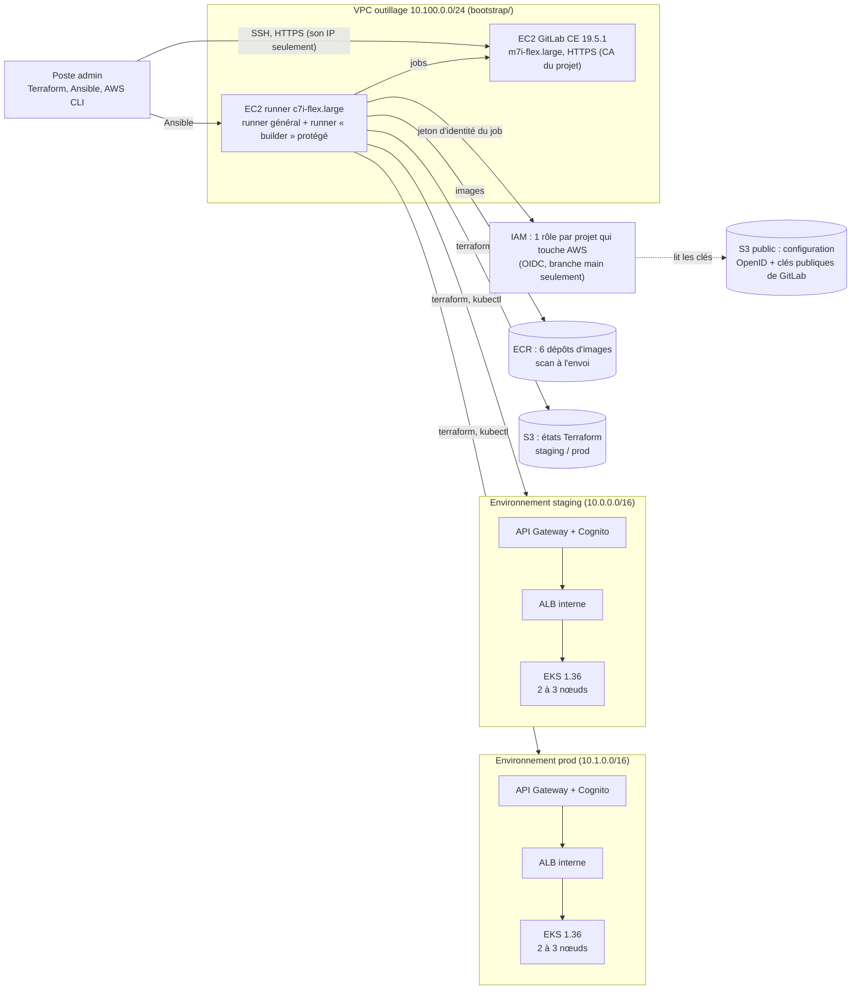
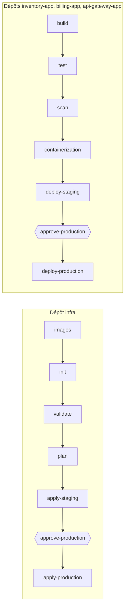

# Code review — code-keeper

Support de la présentation au responsable pédagogique. Les détails sont dans le
[README](README.md) ; les réponses du jeu de rôle sont dans [REVISION-AUDIT.md](REVISION-AUDIT.md) ;
les mots techniques sont expliqués dans le [LEXIQUE](LEXIQUE.md).

## Le message en une phrase

> J'ai construit la chaîne complète qui livre une application en microservices : un GitLab
> installé par Ansible sur AWS, deux environnements identiques créés par Terraform depuis un
> pipeline, et pour chaque application un pipeline qui construit, teste, scanne, puis
> déploie sans coupure. La production attend l'accord d'un responsable, et aucune clé AWS
> n'est stockée dans GitLab.

## Déroulé

| Partie | Ce que je montre |
|---|---|
| 1. Contexte | Ce fichier, les chiffres ci-dessous |
| 2. Architecture | Les deux schémas ci-dessous |
| 3. Visite du code | 4 fichiers du code (le 3.4 est facultatif) |
| 4. Preuves | 2 résultats enregistrés + les tests et Ansible lancés en direct |
| 5. Limites et suite | Ce que je changerais en production |

---

## Avant la séance

1. **Vérifier les dépendances des tests** (déjà installées sur ce PC ; `node_modules/` est
   ignoré par git) :

   ```bash
   for d in inventory-app billing-app api-gateway-app; do (cd "repos/$d" && npm ci); done
   ```

2. **Vérifier la démonstration Ansible** : `(cd ansible && ansible-playbook site.yml --list-tasks)`
   doit afficher 6 plays. Elle n'a pas besoin des machines.
3. **Ouvrir ce fichier en aperçu** (`Ctrl+Shift+V`) et vérifier que les deux schémas
   s'affichent. L'extension « Markdown Preview Mermaid Support » est installée ; si un schéma
   reste en texte, fermer l'aperçu et le rouvrir, ou ouvrir ce fichier sur le miroir GitHub
   (<https://github.com/CLecart/code-keeper>), qui dessine les schémas sans rien installer.
4. **Ouvrir les onglets dans l'ordre** : cet aperçu, `repos/infra/terraform/envs/staging/main.tf`,
   `repos/infra/.gitlab-ci.yml`, `repos/inventory-app/.gitlab-ci.yml`, `bootstrap/iam.tf`,
   `repos/api-gateway-app/k8s/api-gateway-app.yaml`, et un terminal à la racine du dépôt.
5. **Agrandir la police** de l'éditeur et du terminal (`Ctrl` + `+`).
6. **Ne pas ouvrir** `bootstrap/terraform.tfvars` ni `ansible/inventory/hosts.yml` (mon IP et
   celles des machines), ni les journaux de `preuves/` autres que ceux cités ici : 13 d'entre
   eux montrent le numéro du compte AWS.

**Pas de démonstration AWS en direct.** Tout a été supprimé le 22 octobre, après l'audit :
les deux environnements, puis le socle (GitLab, le runner, ECR, les stockages S3, les rôles
IAM). Tout reconstruire prend plus de 40 minutes (socle ≈ 2 min, Ansible ≈ 8 min, pipeline
`infra` ≈ 16 min pour staging puis ≈ 13 min pour la prod, puis les applications) et coûte
environ 1 $ de l'heure tout allumé. Les résultats enregistrés suffisent pour une revue de code.

---

## 1. Contexte

À dire :

- Le sujet : une entreprise passe en mode Agile et veut livrer souvent sans casser la
  production. Il faut un GitLab et ses runners installés par Ansible, un dépôt par
  application et un dépôt d'infrastructure, des pipelines CI/CD, et de la sécurité
  (branches protégées, aucun secret dans le code, moindre privilège, mises à jour).
- Les 3 applications et l'architecture AWS viennent de mon projet cloud-design. **Ce qui est
  nouveau** : `bootstrap/` (le socle AWS), tout `ansible/`, le module Terraform appelé pour
  deux environnements, les 5 pipelines, les tests d'intégration, Renovate, et les scripts
  de contrôle (protections, droits Kubernetes, coupure).
- L'audit a été validé le 22 octobre 2026.

| Chiffre | Valeur |
|---|---|
| Dépôts GitLab | 5 : `inventory-app`, `billing-app`, `api-gateway-app`, `infra`, `renovate` |
| Ansible | 6 plays, 62 tâches ; relancé, il ne change rien (`changed=0`) |
| Terraform | 54 ressources pour le socle ; 91 par environnement |
| Pipeline `infra` | Staging ≈ 16 min, prod ≈ 13 min après approbation |
| Pipeline d'une application | ≈ 2 min 30 jusqu'à staging, 14 s pour la prod (mesuré avant l'ajout de `integration-test` et `lint`) |
| Tests | 101 tests unitaires (40 + 39 + 22), 16 tests d'intégration (9 + 4 + 3), scénario de bout en bout 16/16 |
| Sans coupure | 740 requêtes sur 740 en prod pendant un vrai déploiement |
| Coût | ≈ 1 $/h tout allumé ; 0 $ depuis la suppression |

## 2. Architecture

### 2.1 Les machines et les environnements

Suivre le schéma avec la souris (c'est le même que dans le
[README §0.2](README.md#02-architecture)) :



1. depuis mon poste, Terraform crée le **socle** (`bootstrap/`) : les machines GitLab et
   runner, les registres d'images ECR, le stockage des états Terraform, les rôles IAM ;
2. Ansible installe et configure GitLab et ses **2 runners** ;
3. le runner exécute les jobs ; pour agir sur AWS, un job échange son **jeton d'identité**
   contre le rôle IAM de **son** projet (OIDC), et seulement sur la branche `main` ;
4. le pipeline `infra` crée **staging** et **prod** avec le même code : seuls le nom et le
   réseau changent.

À dire : « GitLab est fermé à Internet, et il n'y a aucune clé AWS dans GitLab ni sur le
runner : chaque job reçoit des droits pour une heure au plus. »

### 2.2 Les pipelines

C'est le même schéma que dans le [README §0.3](README.md#03-les-pipelines) :



À dire : « Sur une branche de travail, le pipeline vérifie seulement, sans aucun accès AWS.
Sur `main`, il construit l'image, la déploie en staging, puis attend qu'un Maintainer
approuve ; c'est la même image qui part en production. »

## 3. Visite du code

### 3.1 Deux environnements, un seul code

[repos/infra/terraform/envs/staging/main.tf](repos/infra/terraform/envs/staging/main.tf)

| Lignes | Ce qu'on y voit |
|---|---|
| [14-19](repos/infra/terraform/envs/staging/main.tf#L14-L19) | L'état Terraform dans S3, une clé par environnement, avec un verrou : deux pipelines ne peuvent pas le modifier en même temps |
| [34-43](repos/infra/terraform/envs/staging/main.tf#L34-L43) | Le même module, appelé avec un nom et une plage réseau |

Dans le terminal :

```bash
diff repos/infra/terraform/envs/staging/main.tf repos/infra/terraform/envs/prod/main.tf
```

Résultat : 3 endroits seulement, la clé de l'état, l'étiquette `Environment`, puis le nom et
le réseau.

Puis [repos/infra/.gitlab-ci.yml](repos/infra/.gitlab-ci.yml) :

| Lignes | Ce qu'on y voit |
|---|---|
| [32-39](repos/infra/.gitlab-ci.yml#L32-L39) | Les 7 étapes demandées par le sujet, dans le même ordre |
| [41-45](repos/infra/.gitlab-ci.yml#L41-L45) | `DESTROY` : le même pipeline supprime les deux environnements en fin de séance |
| [199-211](repos/infra/.gitlab-ci.yml#L199-L211) | Le plan est enregistré, et gardé un jour |
| [234-240](repos/infra/.gitlab-ci.yml#L234-L240) | `apply` applique **exactement** ce plan, rien d'autre |
| [332-347](repos/infra/.gitlab-ci.yml#L332-L347) | `approve-production` : un job manuel ; tant que personne ne le lance, la prod ne bouge pas |

À dire : « Staging et prod sont deux appels du même code : ce qui a marché en staging est
ce qui part en prod. »

### 3.2 Le pipeline d'une application

[repos/inventory-app/.gitlab-ci.yml](repos/inventory-app/.gitlab-ci.yml)

| Lignes | Ce qu'on y voit |
|---|---|
| [21-22](repos/inventory-app/.gitlab-ci.yml#L21-L22) | Les 2 seules lignes qui changent entre les 3 applications |
| [38-45](repos/inventory-app/.gitlab-ci.yml#L38-L45) | Les 7 étapes : build, test, scan, image, staging, approbation, production |
| [55-56](repos/inventory-app/.gitlab-ci.yml#L55-L56) | `.on-main` : seuls les jobs de `main`, branche protégée, touchent AWS |
| [168-170](repos/inventory-app/.gitlab-ci.yml#L168-L170) | L'image n'est construite que si **tous** les contrôles ont réussi |
| [176-184](repos/inventory-app/.gitlab-ci.yml#L176-L184) | L'image est construite, scannée par Trivy, et poussée dans ECR seulement si le scan est propre ; une image déjà poussée n'est jamais reconstruite |
| [233-244](repos/inventory-app/.gitlab-ci.yml#L233-L244) | `approve-production` : seuls les Maintainers peuvent le lancer |
| [246-249](repos/inventory-app/.gitlab-ci.yml#L246-L249) | `deploy-production` : la même image que staging |

À dire : « Avec `needs`, un job démarre dès que les jobs de sa liste ont réussi, quoi que
fassent les autres. Il manquait `integration-test` et `lint` dans cette liste : leur échec
n'aurait pas bloqué l'image. Je les ai ajoutés. »

### 3.3 Aucune clé AWS : OIDC et moindre privilège

[bootstrap/iam.tf](bootstrap/iam.tf)

| Lignes | Ce qu'on y voit |
|---|---|
| [44-48](bootstrap/iam.tf#L44-L48) | Le rôle n'accepte que le jeton de **son** projet, sur la branche `main` |
| [52-59](bootstrap/iam.tf#L52-L59) | Un rôle par projet, avec des droits valables une heure au plus |
| [67-79](bootstrap/iam.tf#L67-L79) | Interdiction : aucun pipeline ne peut toucher aux machines GitLab et runner |
| [186-204](bootstrap/iam.tf#L186-L204) | Le rôle `infra` ne peut créer un rôle que s'il porte une **limite de permissions** : il ne peut pas se donner plus de droits |
| [312-316](bootstrap/iam.tf#L312-L316) | Une application ne peut pousser que **sa** propre image |

Montrer ensuite la preuve, obtenue avec le simulateur de politiques IAM d'AWS
(`preuves/2026-10-22-iam-fixes/simulateur.log`) :

```text
== 1. lecture de la version AMI EKS (attendu: allowed)
ssm:GetParameter (AMI EKS 1.36)                                allowed
== 2. création de rôles
CreateRole AVEC la limite (attendu: allowed)                   allowed
CreateRole SANS limite (attendu: implicitDeny)                 implicitDeny
PutRolePolicy SANS limite (attendu: implicitDeny)              implicitDeny
Attach AdministratorAccess + limite (attendu: implicitDeny)    implicitDeny
Attach AmazonEKSClusterPolicy + limite (attendu: allowed)      allowed
DeleteRolePermissionsBoundary (attendu: implicitDeny)          implicitDeny
CreatePolicyVersion sur la limite (attendu: implicitDeny)      implicitDeny
CreateRole code-keeper-ci-pirate (attendu: implicitDeny)       implicitDeny
== 3. machines GitLab/runner (étiquette Stack=bootstrap)
ec2:TerminateInstances GitLab (attendu: explicitDeny)          explicitDeny
ec2:StopInstances GitLab (attendu: explicitDeny)               explicitDeny
ec2:ModifyInstanceAttribute GitLab (attendu: explicitDeny)     explicitDeny
ec2:AuthorizeSecurityGroupIngress SG GitLab (explicitDeny)     explicitDeny
ec2:RunInstances environnement (attendu: allowed)              allowed
ec2:DescribeInstances (attendu: allowed)                       allowed
```

À dire : « Une relecture a montré que le rôle de Terraform pouvait se donner plus de droits
en créant un rôle plus puissant que lui. La limite de permissions l'en empêche, et le
simulateur le prouve. »

### 3.4 Un déploiement sans coupure (facultatif)

À montrer seulement s'il reste du temps ; sinon, passer directement aux preuves.

[repos/api-gateway-app/k8s/api-gateway-app.yaml](repos/api-gateway-app/k8s/api-gateway-app.yaml)

| Lignes | Ce qu'on y voit |
|---|---|
| [43-48](repos/api-gateway-app/k8s/api-gateway-app.yaml#L43-L48) | Un nouveau pod doit être prêt avant qu'un ancien s'arrête (`maxUnavailable: 0`) |
| [74-79](repos/api-gateway-app/k8s/api-gateway-app.yaml#L74-L79) | Le pod qui part attend 10 s, le temps que plus aucune requête ne lui soit envoyée |
| [152-155](repos/api-gateway-app/k8s/api-gateway-app.yaml#L152-L155) | 2 copies au minimum, jusqu'à 5 selon la charge |
| [169-183](repos/api-gateway-app/k8s/api-gateway-app.yaml#L169-L183) | Le budget de perturbation : pendant la maintenance d'un nœud, les copies partent une par une |

## 4. Preuves

1. **Les protections**, vérifiées par `Scripts/protection-test.sh` : le script agit comme le
   compte `developer` et essaie ce qu'il ne doit pas pouvoir faire
   (`preuves/2026-10-22-conformite/protection-test-9.log`) :

   ```text
   == acting as developer (Developer role) on code-keeper/inventory-app
     PASS  1. push to main of inventory-app refused (HTTP 403)
     PASS  2. pipeline on main of infra with DESTROY=true refused (HTTP 400: no permission to run a pipeline on main)
     PASS  3. re-running deploy-production (job 338) refused (HTTP 403)
     PASS  4. reading the CI/CD variables of inventory-app refused (HTTP 403)
   == 5. push of branch protection-test-20261022-165854 (allowed)
     PASS  5. push of a new branch accepted (HTTP 201)
     branch pipeline 65 jobs: build, dependency-scan, dockerfile-lint, integration-test, lint, sast-gate, semgrep-sast, test
     PASS  6. the branch pipeline only builds, tests and scans (no image, no deployment, no AWS role)
     waiting for the branch pipeline to finish (it may wait for a free runner)...
     PASS  7. the branch pipeline passes (pipeline 65: success)
     PASS  8. creating a project refused (HTTP 403: projects limit 0)
     PASS  9. running approve-production of billing-app (job 313) refused (HTTP 403)

   All protection checks passed
   impersonation token revoked, branch protection-test-20261022-165854 deleted
   ```

2. **Zéro coupure en prod**, pendant un vrai déploiement fait par le pipeline n° 47 : des
   requêtes en continu, et l'approbation cliquée pendant la mesure
   (`preuves/2026-10-22-conformite/zero-downtime-prod-deploiement-47.log`) :

   ```text
   == api-gateway in prod: requests to https://<api>.execute-api.eu-west-3.amazonaws.com/health during a watch
   watching for 240s: approve the deployment now
   deployment "api-gateway" successfully rolled out
   image: api-gateway-app:8c26f43b -> api-gateway-app:bd2c73f5
   requests: 740, answers other than 200: 0
         740 200
   ```

3. **En direct, dans le terminal**, à la racine du dépôt :

   ```bash
   (cd repos/billing-app && npm test)
   ```

   Résultat attendu : `ℹ tests 39`, `ℹ pass 39`, `ℹ fail 0`. Avec les deux autres
   applications : 101 tests. Si un avertissement `DEP0060` s'affiche (api-gateway-app), il
   vient des bibliothèques `http-proxy` et `amqplib`, pas de mon code.

   ```bash
   (cd ansible && ansible-playbook site.yml --list-tasks)
   ```

   Résultat attendu : les 6 plays et leurs 62 tâches, ce que l'auditeur demande de voir.

## 5. Limites et suite

À dire, honnêtement :

- **Un seul GitLab et une seule machine runner** : pas de haute disponibilité, et 2 jobs à
  la fois au plus.
- **Bases, RabbitMQ et `billing-app` en une seule copie** : la maintenance d'un nœud les
  redémarre ailleurs, et ce qui en dépend est indisponible pendant ce temps.
- **L'approbation repose sur le droit de fusionner dans `main`** : une liste nominative
  d'approbateurs (environnements protégés) demande GitLab Premium.
- **Une autorité de certification à moi pour HTTPS**, faute de nom de domaine : le
  navigateur avertit tant que son certificat n'est pas importé.
- **4 défauts signalés par Trivy, acceptés et justifiés** dans `.trivyignore.yaml` du dépôt
  `infra`.

En production : GitLab en haute disponibilité (ou GitLab.com), des runners qui s'ajoutent
selon la charge, un nom de domaine avec un vrai certificat, des bases gérées (RDS
Multi-AZ), une NAT par zone, et les environnements protégés de GitLab Premium.

---

## Questions probables

| Question | Réponse courte | Où le montrer |
|---|---|---|
| Pourquoi GitLab sur AWS et pas sur ton PC ? | GitLab demande 8 Go de mémoire, mon PC n'en a pas assez de libre ; et le runner doit le joindre même quand mon PC est éteint | [README §9](README.md#9-choix-techniques-et-alternatives) |
| Pourquoi OIDC plutôt que des clés AWS dans des variables masquées ? | Il n'y a aucune clé à voler ; les droits durent une heure et dépendent du projet **et** de la branche | [iam.tf L44-48](bootstrap/iam.tf#L44-L48) |
| Comment AWS vérifie-t-il les jetons d'un GitLab fermé à Internet ? | Ansible dépose une copie des clés publiques de GitLab dans un stockage S3 public, lisible pour ces 2 documents seulement ; c'est la méthode de la documentation GitLab | [oidc.tf L20-21](bootstrap/oidc.tf#L20-L21), [L50-59](bootstrap/oidc.tf#L50-L59) |
| Qui peut approuver la prod ? | Les Maintainers seulement (`stakeholder`, `clecart`) : lancer un job manuel de `main` demande le droit d'y fusionner. `developer` est refusé (403) | [.gitlab-ci.yml L233-244](repos/inventory-app/.gitlab-ci.yml#L233-L244) |
| Que se passe-t-il si un test ou un scan échoue ? | Pas d'image, donc pas de déploiement | [.gitlab-ci.yml L168-170](repos/inventory-app/.gitlab-ci.yml#L168-L170) |
| Pourquoi la même image en staging et en prod ? | Ce qui part en prod est exactement ce qui a été testé ; ECR refuse de réécrire une étiquette | [ecr.tf L8-9](bootstrap/ecr.tf#L8-L9) |
| Un développeur peut-il construire une image avec Docker ? | Non : le runner qui a accès à Docker ne prend que les jobs des branches protégées, et un Developer ne peut pas créer de projet à lui | [runner L15-20](ansible/roles/gitlab_runner/defaults/main.yml#L15-L20) |
| Comment gardes-tu les dépendances à jour ? | Renovate, chaque jour ouvré à 7 h : une demande de fusion testée par mise à jour ; celle de sécurité de `morgan` a été fusionnée et déployée le jour même | [main.yml L59-61](ansible/group_vars/all/main.yml#L59-L61), [default.json L5-9](repos/renovate/default.json#L5-L9) |
| Pourquoi les bases sont-elles dans `infra` et pas avec leur application ? | Un déploiement d'application ne les redémarre jamais | [README §9](README.md#9-choix-techniques-et-alternatives) |
| Pourquoi Trivy et le SAST de GitLab, pas Snyk ou SonarQube ? | Gratuits, sans compte ni limite ; Trivy couvre les dépendances, les secrets, les images et le Terraform | [README §9](README.md#9-choix-techniques-et-alternatives) |
| Comment as-tu testé ? | 101 tests unitaires, 16 tests d'intégration contre de vrais PostgreSQL et RabbitMQ, scénario de bout en bout 16/16, et des scripts de contrôle : protections 9/9, droits Kubernetes 118/118 | [test-api.sh](Scripts/test-api.sh), [protection-test.sh](Scripts/protection-test.sh), [rbac-test.sh](Scripts/rbac-test.sh) |
| Quelle a été la plus grosse difficulté ? | Le moindre privilège réel : le rôle de Terraform pouvait se donner plus de droits, et le pipeline d'une application pouvait modifier les bases ; corrigé par une limite de permissions et un Role Kubernetes par application | [README §10](README.md#10-dépannage--problèmes-rencontrés), [rbac.yaml](repos/infra/platform/rbac.yaml) |
