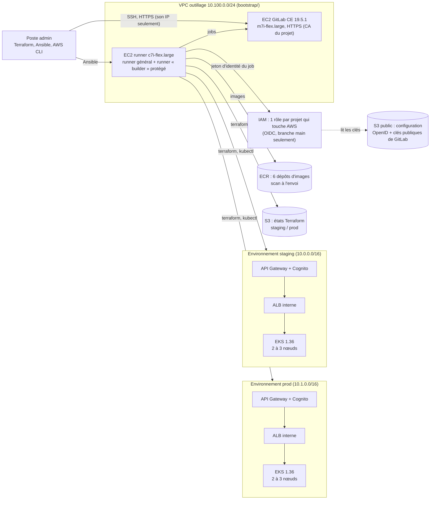
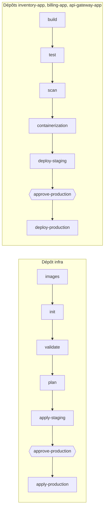

# code-keeper — Pipelines CI/CD sécurisés pour des microservices (GitLab, Ansible, Terraform, AWS)

**Auteur :** `clecart` — **Région :** `eu-west-3` (Paris) — **Pile :** GitLab CE 19.5.1 · GitLab Runner 19.5.0 ·
Ansible 2.21.5 · Terraform 1.16.6 (fournisseur AWS 6.69.1, modules VPC 6.7.3 et EKS 21.29.0) · Amazon EKS 1.36 ·
Trivy 0.76.1 · Renovate 44.176.2 · Node.js 24

Ce document est à la fois le **compte-rendu** du projet et sa **documentation complète** : architecture, coûts,
prérequis, installation, utilisation, pipelines, sécurité, scénario d'audit, choix techniques et dépannage. Les
résultats cités ont été mesurés sur l'infrastructure réellement construite depuis ce dépôt (séances des 21 et
22 octobre 2026). La préparation du jeu de rôle de l'audit est dans [REVISION-AUDIT.md](REVISION-AUDIT.md).

> **Démarrage rapide** — prérequis : un compte AWS, l'AWS CLI configurée, Terraform, Ansible, Docker, kubectl, `jq`
> et une clé SSH personnelle `~/.ssh/id_ed25519` ([§1](#1-prérequis)).
>
> ```bash
> git clone https://zone01normandie.org/git/clecart/code-keeper.git && cd code-keeper
>
> # 1. Socle AWS, une seule fois : machines GitLab et runner, ECR, état Terraform, OIDC
> ssh-keygen -t ed25519 -N "" -f ~/.ssh/code-keeper
> cp bootstrap/terraform.tfvars.example bootstrap/terraform.tfvars   # y mettre son IP publique
> terraform -chdir=bootstrap init && terraform -chdir=bootstrap apply
>
> # 2. GitLab, ses comptes, ses projets et ses 2 runners (Ansible, ~8 min)
> Scripts/init-secrets.sh && Scripts/make-hosts.sh
> ansible-galaxy collection install -r ansible/requirements.yml
> (cd ansible && ansible-playbook site.yml)
>
> # 3. Les dépôts dans GitLab, l'infrastructure d'abord : chaque publication lance son pipeline, sauf renovate
> #    (lancé par sa programmation, que le playbook crée une fois le dépôt publié)
> Scripts/repos.sh push infra renovate && (cd ansible && ansible-playbook site.yml --limit localhost)
> #    -> dans GitLab, un Maintainer lance « approve-production » du pipeline infra ; attendre sa fin (≈ 16 + 13 min)
> Scripts/repos.sh push inventory-app billing-app api-gateway-app
> #    -> puis « approve-production » du pipeline de chaque application
>
> # 4. Vérifier l'application de bout en bout (16 contrôles chacun)
> Scripts/test-api.sh staging && Scripts/test-api.sh prod
>
> # Fin de séance : pipeline infra lancé à la main avec DESTROY=true, puis
> Scripts/tooling.sh stop && Scripts/inventory.sh
> ```
>
> Les deux environnements allumés coûtent environ **0,77 $ de l'heure**, GitLab et le runner **0,23 $**
> ([§2](#2-coûts-et-maîtrise-des-dépenses)) : **chaque** séance se termine par la suppression des environnements
> et l'arrêt des machines.

---

## Sommaire

0. [Vue d'ensemble](#0-vue-densemble)
1. [Prérequis](#1-prérequis)
2. [Coûts et maîtrise des dépenses](#2-coûts-et-maîtrise-des-dépenses)
3. [Organisation du dépôt](#3-organisation-du-dépôt)
4. [Installation pas à pas](#4-installation-pas-à-pas)
5. [Utilisation](#5-utilisation)
6. [Les pipelines en détail](#6-les-pipelines-en-détail)
7. [Sécurité](#7-sécurité)
8. [Scénario d'audit pas à pas](#8-scénario-daudit-pas-à-pas)
9. [Choix techniques et alternatives](#9-choix-techniques-et-alternatives)
10. [Dépannage : problèmes rencontrés](#10-dépannage--problèmes-rencontrés)
11. [Limites connues](#11-limites-connues)

---

## 0. Vue d'ensemble

### 0.1 Ce que fait le projet

Une entreprise passe en mode Agile et veut livrer souvent, sans casser la production. Ce projet construit pour elle
une **chaîne complète** qui scanne et déploie une application en microservices :

| Besoin | Réponse |
|---|---|
| Un gestionnaire de code et de pipelines | **GitLab CE** auto-hébergé, installé et configuré par **Ansible**, avec **2 runners** |
| Le code des applications | 3 dépôts : `inventory-app`, `billing-app`, `api-gateway-app` (mon propre code Node.js de cloud-design) |
| L'infrastructure | 1 dépôt indépendant, `infra` : **Terraform** de 2 environnements identiques, **staging** et **prod** |
| Créer, modifier, supprimer l'infrastructure | Pipeline `infra` : Init → Validate → Plan → Apply staging → **Approbation** → Apply production |
| Construire, tester, scanner | Pipeline CI de chaque application : Build → Test → Scan → Image Docker (ECR) |
| Livrer | Pipeline CD de chaque application : Staging → **Approbation** → Production, **sans coupure** (limites : [§11](#11-limites-connues)) |
| Sécurité | Branches protégées, aucun secret dans le code, moindre privilège (OIDC), mises à jour automatiques (Renovate) |

L'application elle-même est celle de cloud-design : une API de films (`inventory-app` + PostgreSQL), un service de
facturation (`billing-app` + PostgreSQL) alimenté par une file **RabbitMQ**, et une passerelle (`api-gateway-app`)
publiée par **API Gateway** en HTTPS, derrière une authentification **Cognito**.

### 0.2 Architecture



- **GitLab reste fermé** : seuls l'IP de l'administrateur et le runner le joignent. AWS vérifie les jetons des
  pipelines avec une copie des **clés publiques** de GitLab, déposée dans un stockage S3 public (méthode de la
  documentation GitLab pour une instance non publique).
- **Aucune clé AWS** dans GitLab, sur le runner ou dans les pipelines : chaque job échange son jeton d'identité (OIDC)
  contre le rôle IAM de **son** projet, et seulement sur la branche protégée `main` (la seule clé est celle du poste
  admin, [§1.3](#13-accès)).
- Les deux environnements sont créés par le **même module Terraform** : seuls leur nom et leur plage réseau changent.

### 0.3 Les pipelines



| Événement | Ce qui tourne |
|---|---|
| Push ou demande de fusion sur une branche de travail | CI seulement, sans aucun accès AWS : build, test, scan (applications) ; `init` et `validate` sur une demande de fusion (`infra`) |
| Push sur `main` (protégée) | CI, image, déploiement en staging, puis **attente d'un Maintainer** pour la production |
| Pipeline `infra` lancé à la main avec `DESTROY=true` (Maintainers seulement) | Suppression de staging, puis de la prod après approbation |
| Programmation du projet `renovate` (chaque jour ouvré à 7 h) | Demandes de fusion de mises à jour de dépendances |

### 0.4 Correspondance avec les exigences du sujet

| Exigence | Où | Comment |
|---|---|---|
| GitLab déployé et configuré par Ansible | [ansible/](ansible/) | `site.yml` : CA du projet, système, GitLab (comptes, réglages, projets, variables CI), runners |
| GitLab sur le cloud ou en local, accessible à l'équipe | [bootstrap/](bootstrap/) | EC2 à IP fixe, HTTPS, comptes `clecart`, `stakeholder`, `developer` |
| Runners intégrés aux pipelines | [ansible/roles/gitlab_runner/](ansible/roles/gitlab_runner/) | 2 runners Docker enregistrés par l'API, en ligne, utilisés par tous les projets |
| Un dépôt par application, un dépôt d'infrastructure indépendant | [repos/](repos/) | `inventory-app`, `billing-app`, `api-gateway-app`, `infra` (+ `renovate`) |
| Infrastructure de cloud-design sur 2 environnements similaires, avec Terraform | [repos/infra/terraform/](repos/infra/terraform/) | Un module, deux appels : seuls le nom et le réseau diffèrent |
| Étapes Init, Validate, Plan, Apply staging, Approval, Apply production | [repos/infra/.gitlab-ci.yml](repos/infra/.gitlab-ci.yml) | Même ordre ; `DESTROY=true` pour supprimer (vérifié : pipeline n° 36, 91 ressources détruites par environnement) |
| CI : Build, Test, Scan, Containerization | [repos/inventory-app/.gitlab-ci.yml](repos/inventory-app/.gitlab-ci.yml) | npm ci, tests Node, SAST GitLab + Trivy + hadolint, image scannée poussée dans ECR |
| CD : Deploy staging, Approval, Deploy production sans coupure | même fichier ; manifestes `k8s/` de chaque application | Mise à jour progressive (`maxUnavailable: 0`), vérifiée sans aucune erreur, de même que la vidange d'un nœud ([§6.3](#63-déploiement-sans-coupure)) |
| Toute modification du code redéployée en staging puis en prod après approbation | idem | Push sur `main` → nouvelle image → staging → approbation → prod |
| Déclenchement limité aux branches protégées | [§7.1](#71-déclenchement-limité-aux-branches-protégées) | `main` protégée, variables protégées, rôles AWS liés à `main`, test automatique |
| Secrets hors du code | [§7.2](#72-secrets-hors-du-code) | Ansible Vault, variables masquées, OIDC, secrets créés dans le cluster |
| Moindre privilège | [§7.3](#73-moindre-privilège) | Un rôle AWS par projet qui en a besoin, limite de permissions, Pod Security, quotas, rôles GitLab |
| Mises à jour régulières et automatisées | [§7.4](#74-mises-à-jour-et-alertes-de-sécurité) | Renovate chaque jour ouvré, Trivy, scan ECR, correctifs Ubuntu automatiques, versions figées |
| README complet | ce fichier | + [REVISION-AUDIT.md](REVISION-AUDIT.md) |
| Bonus | [§9](#9-choix-techniques-et-alternatives) | Mon propre crud-master, OIDC sans clé, Renovate, tests de protection et de coupure |

---

## 1. Prérequis

### 1.1 Compte AWS

- Un compte AWS sur le **plan gratuit** (crédits de 200 $). Ce plan ne débite jamais la carte, mais **ferme le
  compte** quand les crédits sont épuisés : d'où la discipline de fin de séance ([§2.3](#23-protections)).
- Machines autorisées sur ce plan à Paris (vérifié avec
  `aws ec2 describe-instance-types --filters Name=free-tier-eligible,Values=true`) : `t3/t4g/t8i.micro|small`,
  `c7i-flex.large` (4 Gio), `m7i-flex.large` (8 Gio). GitLab demande 8 Go : il tourne sur `m7i-flex.large`.
- Quotas utilisés : 32 vCPU autorisés (16 au maximum avec tout allumé), 4 IP fixes sur 5, 4 VPC sur 5 (dont
  celui créé par défaut par AWS).
- Interdits sur le plan gratuit et donc évités : AWS Organizations, Control Tower, IAM Identity Center, Amazon
  Inspector, Managed Grafana, GuardDuty.

### 1.2 Outils sur la machine d'administration

| Outil | Version utilisée | Rôle |
|---|---|---|
| Terraform | 1.16.6 | `bootstrap/` (socle) ; les environnements passent par le pipeline |
| Ansible (ansible-core) | 2.21.5 (+ collection `community.crypto` 3.5.1) | Installation et configuration de GitLab et des runners |
| AWS CLI | 2.38.2 | Scripts, vérifications |
| kubectl / Helm | 1.36.4 / 4.3.1 | Vérifications et démonstrations |
| Docker | 29.9 | shellcheck, hadolint, validateur Renovate en local |
| jq, git (avec `git subtree`), ssh | — | Scripts |

### 1.3 Accès

- Une identité AWS d'administration dans `~/.aws/credentials` (ici l'utilisateur IAM `clecart-admin`), qui ne sert
  qu'à `bootstrap/`, au playbook Ansible (publication des clés OIDC dans S3) et aux scripts d'administration. Les
  pipelines ne l'utilisent jamais.
- Une clé SSH dédiée `~/.ssh/code-keeper` (machines GitLab et runner) et sa clé publique personnelle
  `~/.ssh/id_ed25519.pub`, ajoutée au compte GitLab `clecart` par Ansible (pour `git push`).
- Son IP publique (`curl -s https://checkip.amazonaws.com`) dans `bootstrap/terraform.tfvars` : GitLab, le SSH et
  l'API des clusters EKS ne sont ouverts qu'à elle (et au runner).

---

## 2. Coûts et maîtrise des dépenses

### 2.1 Prix vérifiés (liste de prix officielle AWS, Paris, octobre 2026)

| Élément | Prix |
|---|---|
| GitLab `m7i-flex.large` | 0,11172 $/h |
| Runner `c7i-flex.large` | 0,10075 $/h |
| Cluster EKS (support standard ; 1.31 à 1.33 seraient en support étendu à 0,50 $/h) | 0,10 $/h |
| Nœud EKS `c7i-flex.large` (×2 par environnement) | 0,10075 $/h |
| Passerelle NAT (+ son IP) | 0,05 $/h + 0,005 $/h |
| ALB interne | 0,02646 $/h (+ 0,0084 $/LCU-h) |
| IP publique (allumée ou non) | 0,005 $/h |
| Disque gp3 | 0,0928 $/Go-mois |
| ECR | 0,10 $/Go-mois ; transfert vers EKS dans la région gratuit |
| S3 (états, documents OIDC) | 0,024 $/Go-mois, quelques Ko ici |

### 2.2 Coût d'une séance

| Situation | Coût |
|---|---|
| Un environnement allumé | ≈ 0,38 $/h |
| Les deux environnements | ≈ 0,77 $/h |
| GitLab + runner allumés | ≈ 0,23 $/h |
| **Tout allumé** | **≈ 1 $/h** |
| GitLab + runner **éteints** (disques 70 Go + 2 IP fixes) | ≈ 13,80 $/mois (0,46 $/jour) |
| Environnements oubliés allumés | ≈ 18 $/jour : les crédits seraient épuisés en 10 jours |

Les crédits restants se lisent avec `aws freetier get-account-plan-state --region us-east-1`.

### 2.3 Protections

- **Fin de séance obligatoire** : pipeline `infra` avec `DESTROY=true` (suppression des 2 environnements, avec
  leurs disques), puis `Scripts/tooling.sh stop` et `Scripts/inventory.sh`, qui doit répondre `OK`.
- Les machines GitLab et runner sont **éteintes**, jamais détruites : GitLab, ses dépôts et ses pipelines restent.
- Un **quota Kubernetes** interdit aux pipelines de créer un load balancer AWS hors de Terraform
  ([§7.3](#73-moindre-privilège)).
- ECR garde les 30 dernières images de chaque dépôt ; les journaux CloudWatch sont gardés un jour.
- Un budget AWS mensuel de 10 $ prévient par e-mail à 50 % et 100 %.

---

## 3. Organisation du dépôt

```text
code-keeper/
├── README.md, REVISION-AUDIT.md
├── bootstrap/                 Terraform du socle (lancé depuis le poste admin, état local)
│   ├── network.tf             VPC outillage, sous-réseau public, pas de NAT
│   ├── instances.tf           EC2 GitLab et runner (Ubuntu 24.04, IMDSv2, disques chiffrés, IP fixes)
│   ├── security-groups.tf     GitLab : IP admin + IP du runner ; runner : SSH admin
│   ├── ecr.tf                 6 dépôts d'images immuables, scan à l'envoi, 30 images gardées
│   ├── state-bucket.tf        S3 des états staging/prod (versionné, chiffré, TLS obligatoire)
│   ├── oidc.tf                Stockage public des clés de GitLab + fournisseur OIDC IAM
│   └── iam.tf                 Rôles CI par projet, limite de permissions, interdiction sur le socle
├── ansible/
│   ├── site.yml               6 plays : pki, common, gitlab, gitlab_oidc, gitlab_projects, gitlab_runner
│   ├── group_vars/all/        main.yml (versions, comptes, projets) ; vault.yml chiffré (ignoré par Git)
│   └── roles/                 pki, common, gitlab, gitlab_oidc, gitlab_projects, gitlab_runner
├── repos/                     Contenu des 5 dépôts GitLab (publiés avec Scripts/repos.sh)
│   ├── inventory-app/         Code, tests, Dockerfile, k8s/, .gitlab-ci.yml, renovate.json
│   ├── billing-app/           idem
│   ├── api-gateway-app/       idem
│   ├── infra/                 terraform/ (module + envs/staging, envs/prod), platform/, images/, scripts/
│   └── renovate/              Pipeline et réglages communs de Renovate
└── Scripts/                   Outils d'administration (voir §5.1)
```

Les 5 dépôts GitLab vivent dans `repos/` : `Scripts/repos.sh push` les publie avec `git subtree` (l'historique
est gardé), `Scripts/repos.sh pull` ramène ce qui a été fusionné dans GitLab (par exemple une mise à jour Renovate).

---

## 4. Installation pas à pas

### 4.1 Le socle AWS (`bootstrap/`, une seule fois)

```bash
ssh-keygen -t ed25519 -N "" -f ~/.ssh/code-keeper
cp bootstrap/terraform.tfvars.example bootstrap/terraform.tfvars    # admin_cidrs = ["<son IP>/32"]
terraform -chdir=bootstrap init
terraform -chdir=bootstrap plan    # 54 ressources
terraform -chdir=bootstrap apply
```

Création en 2 minutes environ. L'état de ce socle reste local (ignoré par Git) : c'est lui qui crée le stockage S3
des états des environnements.

### 4.2 GitLab et ses runners (Ansible)

```bash
Scripts/init-secrets.sh        # mot de passe du coffre (~/.config/code-keeper) + secrets aléatoires chiffrés
Scripts/make-hosts.sh          # inventaire Ansible depuis les sorties de bootstrap (ignoré par Git)
ansible-galaxy collection install -r ansible/requirements.yml
cd ansible
ansible-playbook site.yml --list-tasks    # ce que l'auditeur demande de voir
ansible-playbook site.yml                 # ~8 min la première fois ; relancé aussitôt, il ne change rien
cd ..
```

| Play | Ce qu'il fait |
|---|---|
| `pki` (poste admin) | Autorité de certification du projet et certificat HTTPS de GitLab (pas de nom de domaine) |
| `common` | Mises à jour de sécurité automatiques, mise à jour des paquets, redémarrage si besoin |
| `gitlab` | Dépôt de paquets GitLab, GitLab CE 19.5.1 figé, HTTPS, jetons (Ansible, Renovate), réglages de l'instance, comptes |
| `gitlab_oidc` | Publie la configuration OpenID et les clés publiques de GitLab dans le stockage S3 public |
| `gitlab_projects` | Groupe `code-keeper`, membres et rôles, 5 projets, `main` protégée, variables CI, programmation Renovate |
| `gitlab_runner` | Docker Engine, GitLab Runner 19.5.0 figé, 2 runners créés par l'API, nettoyage hebdomadaire |

Réglages de l'instance appliqués par l'API : inscriptions fermées, mots de passe de 12 caractères au moins, tout
privé (le niveau « public » est interdit), branche par défaut `main` protégée, Auto DevOps désactivé, jeton
d'inscription des runners désactivé.

Mots de passe des comptes : `cd ansible && ansible-vault view group_vars/all/vault.yml`.

### 4.3 Les dépôts GitLab

```bash
Scripts/repos.sh push infra renovate                         # l'infrastructure d'abord
(cd ansible && ansible-playbook site.yml --limit localhost)   # crée la programmation de Renovate (dépôt non vide)
# une fois les 2 environnements créés (pipeline infra et son approbation, ≈ 30 min) :
Scripts/repos.sh push inventory-app billing-app api-gateway-app
```

Chaque publication sur `main` lance le pipeline du dépôt (sauf `renovate`, lancé par sa programmation). Les
applications se publient après `infra` : leur déploiement a besoin du cluster et de l'espace `code-keeper`.

### 4.4 Les environnements (pipeline `infra`)

Le premier push de `infra` crée staging (≈ 16 min avec la plateforme), puis attend l'approbation ; la prod suit en
≈ 13 min. Durées mesurées (pipeline n° 5) : images 1 min 41, init 28 s, validate 26 s, plans 39 s, apply staging
9 min 48, plateforme staging 1 min 33, apply production 11 min 20, plateforme production 1 min 42.

La suppression (`DESTROY=true`, pipeline n° 36) prend ≈ 14 min pour staging (init 21 s, validate 26 s, plans 45 s,
`remove-platform` 54 s, `destroy` 11 min 13 s), puis ≈ 12 min pour la prod après l'approbation (`remove-platform`
44 s, `destroy` 11 min 22 s) : 91 ressources détruites de chaque côté. Vérifié ensuite sur AWS : plus aucun cluster,
VPC, ALB, API Gateway, groupe Cognito, groupe de journaux, disque ou rôle IAM des environnements, et l'inventaire des
17 régions ne trouve plus que GitLab et le runner.

### 4.5 Les applications

Le premier push de chaque application construit son image et la déploie en staging (≈ 2 min 30), puis en prod
après approbation (14 s). Mesures (pipeline n° 6 d'inventory-app) : build 10 s, test 5 s, SAST 32 s, Trivy 34 s,
hadolint 4 s, image 34 s, staging 14 s, production 14 s.

### 4.6 La fin de séance

1. GitLab → projet `infra` → **Build → Pipelines → New pipeline**, branche `main`, variable `DESTROY` = `true`
   (Maintainers seulement) ; puis approuver la suppression de la prod.
2. `Scripts/tooling.sh stop` : GitLab et le runner s'éteignent (`Scripts/tooling.sh start` pour la séance suivante).
3. `Scripts/inventory.sh` : 17 régions inventoriées, réponse attendue `OK: only the stopped tooling stack remains`.

Attendre que le pipeline soit terminé (« passed ») avant l'étape 2 : un job arrêté en cours de route laisse le
verrou de l'état Terraform. Si la suppression s'interrompt :

| Situation | Que faire |
|---|---|
| Un job `destroy-*` a échoué | **Retry** du job : il recalcule son plan de suppression à partir de l'état réel |
| Nouveau pipeline `DESTROY=true` après une suppression partielle | Rien : `remove-platform-*` passe la partie Kubernetes si le cluster est absent ou en cours de suppression, ou si l'accès du pipeline au cluster a déjà été retiré |
| La suppression de staging a échoué | La prod ne peut pas être approuvée dans ce pipeline : finir staging (Retry), puis nouveau pipeline `DESTROY=true` |
| `Error acquiring the state lock` | Vérifier qu'aucun pipeline ne tourne, puis depuis le poste admin : `terraform -chdir=repos/infra/terraform/envs/<env> init -backend-config="bucket=$(terraform -chdir=bootstrap output -raw state_bucket)"` et `terraform -chdir=repos/infra/terraform/envs/<env> force-unlock <ID du message>` |
| Dernier recours | Depuis le poste admin, après le même `init` : `repos/infra/scripts/remove-platform.sh <env>`, puis `terraform -chdir=repos/infra/terraform/envs/<env> destroy` |

---

## 5. Utilisation

### 5.1 Les scripts (`Scripts/`)

| Script | Rôle |
|---|---|
| `init-secrets.sh` | Crée le mot de passe Ansible Vault et le coffre chiffré (secrets aléatoires, jamais affichés) |
| `make-hosts.sh` | Écrit l'inventaire Ansible à partir des sorties de `bootstrap/` |
| `repos.sh push\|pull [dépôt…]` | Publie les dossiers `repos/` dans GitLab, ou ramène les changements fusionnés dans GitLab |
| `tooling.sh start\|stop\|status` | Allume, éteint ou montre les machines GitLab et runner |
| `api-token.sh staging\|prod` | Jeton Cognito d'un utilisateur de test (`auditor`) pour l'API publique |
| `test-api.sh staging\|prod` | Scénario de bout en bout par l'URL publique : 16 contrôles |
| `zero-downtime-test.sh staging\|prod api-gateway\|inventory-app [rollout\|drain]` | Requêtes en continu pendant une mise à jour progressive (`rollout`) ou la vidange d'un nœud (`drain`, nœud remis en service à la fin) ; compte les erreurs |
| `protection-test.sh [application]` | Agit comme `developer` et vérifie qu'il ne peut ni déployer ni toucher à `main` |
| `inventory.sh` | Inventaire des ressources payantes dans les 17 régions (machines, disques, IP, NAT, répartiteurs ALB/NLB et classiques, EKS, RDS, Lambda, groupes de journaux) |

Et dans le dépôt `infra` : `scripts/deploy-platform.sh`, `scripts/remove-platform.sh`, `scripts/build-images.sh`,
`scripts/image-tag.sh`, `scripts/grafana.sh staging|prod` (Grafana sur http://localhost:3001).

### 5.2 Approuver une mise en production

Chaque pipeline de `main` (applications et `infra`) s'arrête sur le job manuel **approve-production**. Pour le lancer, il faut le droit de
fusionner dans `main` (documentation GitLab : *« To run a manual job, you must have permission to merge to the
assigned branch »*) : seuls les **Maintainers** et plus (`stakeholder`, Maintainer ; `clecart`, Owner) le peuvent, pas `developer`. GitLab garde
la trace de qui a approuvé et quand.

### 5.3 Une modification de code, de bout en bout

1. Une branche, un commit, une demande de fusion : le pipeline de la demande fait build, test et scan.
2. Un Maintainer fusionne (seulement si le pipeline est vert et les discussions résolues).
3. Le pipeline de `main` construit la nouvelle image (étiquette = commit), la scanne, la pousse dans ECR, la déploie
   en staging, puis attend l'approbation ; la même image part en production.

### 5.4 Les mises à jour

- **Renovate** ouvre chaque jour ouvré les demandes de fusion de mises à jour ([§7.4](#74-mises-à-jour-et-alertes-de-sécurité)).
- **GitLab et le runner** : changer la version figée dans `ansible/group_vars/all/main.yml`, relancer le playbook
  (GitLab est passé ainsi de 19.5.0 à 19.5.1 après son annonce de correctif critique).

---

## 6. Les pipelines en détail

### 6.1 Pipeline `infra`

| Étape | Job | Détail |
|---|---|---|
| images | `build-platform-images` | Construit, scanne (Trivy) et pousse les images des bases et de RabbitMQ absentes d'ECR (runner « builder ») |
| init | `init-backend` | `terraform init` des 2 environnements avec le stockage d'état S3 (verrou `use_lockfile`) |
| validate | `validate` | `terraform fmt -check` et `terraform validate` des 2 environnements |
| plan | `plan-staging`, `plan-production` | Plans enregistrés (artefacts 1 jour) ; avec `DESTROY=true`, plans de suppression |
| apply-staging | `apply-staging` → `deploy-platform-staging` | Applique **exactement** le plan relu ; puis bases, RabbitMQ, quotas, Pod Security, Prometheus, Grafana, Fluent Bit, autoscaler |
| approval | `approve-production` | Job manuel, réservé aux Maintainers |
| apply-production | `apply-production` → `deploy-platform-production` | Idem en production |

Suppression (`DESTROY=true`) : `remove-platform-*` supprime d'abord l'espace `code-keeper` et attend la disparition
de ses disques EBS (identifiés un par un), puis `destroy-*` recalcule le plan de suppression et l'applique (un
« Retry » fonctionne donc après une interruption, voir [§4.6](#46-la-fin-de-séance)). Sur une demande de
fusion, seuls `init` (sans état) et `validate` tournent, sans aucun accès AWS.

### 6.2 Pipeline des applications

| Étape | Job | Détail |
|---|---|---|
| build | `build` | `npm ci` (versions exactes du `package-lock.json`) et vérification de syntaxe de chaque fichier |
| test | `test` | Tests Node (`node --test`), rapport JUnit affiché dans GitLab : 40, 39 et 22 tests |
| scan | `semgrep-sast` + `sast-gate` | SAST de GitLab (Semgrep) ; `sast-gate` échoue sur une faille haute ou critique |
| scan | `dependency-scan` | Trivy sur les dépendances et les secrets : échoue sur une faille haute ou critique corrigée |
| scan | `dockerfile-lint` | hadolint sur le Dockerfile |
| containerization | `containerization` | `main` seulement : image construite, scannée par Trivy, poussée dans ECR (étiquette = commit, jamais réécrite) |
| deploy-staging | `deploy-staging` | Mise à jour progressive dans staging, attente de la fin du déploiement |
| approval | `approve-production` | Job manuel, Maintainers |
| deploy-production | `deploy-production` | La **même image** en production |

Le scan a servi dès le premier jour : Trivy, lancé avant la mise en place des pipelines, a trouvé une faille
critique (`proxy-addr`, CVE-2026-90711) et deux hautes (`follow-redirects`) dans les dépendances, corrigées avant le
premier pipeline des applications.

### 6.3 Déploiement sans coupure

- Stratégie `RollingUpdate` avec `maxSurge: 1` et `maxUnavailable: 0` : un nouveau pod doit être **prêt** (sondes)
  avant qu'un ancien s'arrête.
- Pause `preStop` de 10 s : le pod sortant reste joignable le temps que tous les nœuds cessent de lui envoyer des
  requêtes.
- api-gateway garde ses connexions 65 s, plus longtemps que l'ALB (60 s) : pas d'erreur 502 sur une connexion fermée.
- Mesure (`Scripts/zero-downtime-test.sh staging …`) : **74 requêtes sur 74** (api-gateway) et **90 sur 90**
  (inventory-app) en HTTP 200 pendant le remplacement des pods.
- Maintenance d'un nœud (mise à jour des nœuds par EKS, `kubectl drain`) : api-gateway et inventory-app gardent
  **2 copies au minimum** et un **budget de perturbation** (`PodDisruptionBudget`, `maxUnavailable: 1`). Les pods d'un
  nœud partent un par un, le suivant seulement quand le remplaçant du précédent est prêt sur un autre nœud. Un pod
  qui n'est pas prêt peut toujours partir (`unhealthyPodEvictionPolicy: AlwaysAllow`) : il ne bloque pas la vidange
  (EKS met la mise à jour des nœuds en échec si un nœud n'est pas vidé en 15 minutes).
- Mesure (`Scripts/zero-downtime-test.sh staging … drain`) : **136 requêtes sur 136** (api-gateway : l'éviction de la
  2ᵉ copie a été refusée par le budget jusqu'à ce que la 1ʳᵉ soit remplacée) et **109 sur 109** (inventory-app).
  Avant ce changement, avec une seule copie, la même mesure donnait déjà 120/120 et 109/109 : la pause de 10 s
  couvrait le démarrage du remplaçant. Le budget retire cette dépendance au délai.

### 6.4 Renovate

Le projet `renovate` lance l'image officielle chaque jour ouvré à 7 h. État le 22 octobre : **9 demandes de fusion**
ouvertes, toutes avec un pipeline vert (Alpine 3.24, `amqplib` 2, `pg`, …), dont une **de sécurité** : `morgan` 1.12.1,
qui corrige deux failles de gravité moyenne (CVE-2026-15603, CVE-2026-87859) signalées par la base OSV ; et un ticket
« Dependency Dashboard » par dépôt. Le compte `renovate-bot` est Developer : il propose, un Maintainer décide.

---

## 7. Sécurité

### 7.1 Déclenchement limité aux branches protégées

- `main` est protégée dans les 5 projets : seuls les Maintainers poussent ou fusionnent, personne ne force.
- Les jobs qui touchent AWS ne tournent que sur `main` (`rules`) ; les variables CI sont **protégées** (données aux
  seules branches protégées) ; les rôles AWS n'acceptent que les jetons de `main` (§7.3).
- Lancer un pipeline sur `main`, ou y passer une variable comme `DESTROY`, demande le rôle Maintainer.
- Le runner « builder », qui a accès à Docker, ne prend que les jobs des branches protégées.
- Vérifié par `Scripts/protection-test.sh` (le compte `developer`, rôle Developer) :

| Tentative de `developer` | Résultat |
|---|---|
| Pousser sur `main` | Refusé (403) |
| Lancer le pipeline `infra` sur `main` avec `DESTROY=true` | Refusé : *« You do not have sufficient permission to run a pipeline on 'main' »* |
| Relancer un déploiement de production | Refusé (403) |
| Lire les variables CI | Refusé (403) |
| Pousser une branche | Permis : son pipeline ne fait que build, test et scan, et il passe |

### 7.2 Secrets hors du code

| Secret | Où il vit |
|---|---|
| Mots de passe GitLab, jetons API d'Ansible et de Renovate | Coffre **Ansible Vault** chiffré, ignoré par Git ; mot de passe du coffre hors du dépôt |
| Accès AWS des pipelines | **Aucune clé** : OIDC, identifiants temporaires d'une heure |
| Jeton de Renovate dans GitLab | Variable CI **masquée et protégée** |
| Mots de passe des bases et de RabbitMQ | Tirés au hasard **dans le cluster** au premier déploiement (secrets Kubernetes), jamais affichés |
| Mot de passe de l'utilisateur Cognito de test | Fichier local `.cognito-test-user-<env>`, mode 600, ignoré par Git |
| Clé privée de la CA du projet | Poste admin seulement (`~/.local/share/code-keeper/pki`) |

Avant chaque commit, les fichiers concernés ont été fouillés (IP, numéro de compte, jetons, mot de passe du coffre) ;
avant chaque push, tout l'historique, avec un contrôle positif pour prouver que la recherche fonctionnait.

### 7.3 Moindre privilège

**AWS (OIDC)** — un rôle par projet, que seul le jeton de **sa** branche `main` peut prendre
(`project_path:code-keeper/<projet>:ref_type:branch:ref:main`) :

| Rôle | Droits |
|---|---|
| `code-keeper-ci-infra` | Services de l'environnement, **à Paris seulement** ; IAM limité aux rôles `code-keeper-staging-*`/`prod-*`, qui doivent porter la limite ci-dessous ; états `envs/*` ; images de plateforme |
| `code-keeper-ci-<application>` | Pousser **sa** seule image ; trouver les clusters ; dans Kubernetes, droits d'édition limités à l'espace `code-keeper` |

- **Limite de permissions** (`code-keeper-environment-boundary`) : tout rôle créé par le pipeline ne peut jamais
  dépasser les droits d'un cluster (EC2, EKS, ELB, journaux, lecture ECR). Le rôle `infra` ne peut ni retirer cette
  limite, ni la modifier, ni attacher d'autres règles que les 5 utilisées par EKS : pas d'escalade vers
  administrateur (prouvé avec le simulateur de politiques IAM).
- **Interdiction explicite** pour le rôle `infra` et les rôles qu'il crée de toucher aux ressources EC2 du socle
  (étiquette `Stack=bootstrap`) ; les rôles des applications n'ont aucun droit EC2. Aucun rôle AWS d'un pipeline ne
  peut donc modifier, éteindre ou ouvrir à Internet GitLab et le runner.
- La machine du runner n'a **aucun rôle AWS**, et les conteneurs des jobs ne peuvent pas joindre son service de
  métadonnées (IMDSv2, limite de saut 1).

**Kubernetes** :
- **Pod Security `restricted`** sur l'espace `code-keeper` : un pod privilégié ou avec accès à la machine est refusé
  (vérifié : *« violates PodSecurity "restricted:v1.36" »*).
- **Quota** : aucun service `LoadBalancer` (un load balancer créé par Kubernetes serait payant et hors de Terraform).
- Pods non-root, système de fichiers en lecture seule, toutes les capacités retirées ; NetworkPolicies : tout le
  trafic entrant est refusé par défaut, puis seuls les flux nécessaires sont ouverts (le trafic sortant reste libre).

**GitLab** : `developer` et `renovate-bot` sont Developer (branches et demandes de fusion), `stakeholder` est
Maintainer (approuve la prod), `clecart` Owner ; les jobs n'ont pas de logs publics ; seuls les Maintainers passent
des variables à un pipeline.

### 7.4 Mises à jour et alertes de sécurité

| Quoi | Comment |
|---|---|
| Dépendances npm, images Docker, Terraform, charts Helm, Trivy | **Renovate**, chaque jour ouvré : une demande de fusion par mise à jour, testée par la CI |
| Failles connues des dépendances directes | Renovate (base **OSV**) : demande de fusion étiquetée `security` |
| Failles des dépendances et des images | **Trivy** à chaque pipeline d'application et sur chaque image de plateforme construite (bloquant) + **scan ECR** à chaque envoi |
| Code | **SAST** de GitLab à chaque pipeline (bloquant sur haute et critique) |
| Système des machines GitLab et runner | Correctifs de sécurité Ubuntu automatiques chaque jour |
| GitLab, runner, charts, modules | Versions **figées**, relevées volontairement (exemple : GitLab 19.5.0 → 19.5.1, correctif critique) |

### 7.5 Autres mesures

- GitLab n'est joignable que par l'IP de l'administrateur et le runner ; HTTPS par la CA du projet ; IMDSv2 ; disques
  chiffrés ; trafic HTTP redirigé vers HTTPS.
- API publique : HTTPS (certificat AWS), jeton Cognito obligatoire sur `/api/*`, limite de débit (20 req/s).
- API des clusters EKS : ouverte seulement à l'IP admin et au runner.

---

## 8. Scénario d'audit pas à pas

| Question de la grille | Démonstration |
|---|---|
| Fichiers du dépôt | `tree -L 2` ; ce README ; `ansible/` ; `repos/*/.gitlab-ci.yml` |
| GitLab déployé par Ansible | `cd ansible && ansible-playbook site.yml --list-tasks` ; relancer `ansible-playbook site.yml` : `changed=0` |
| Services en marche | `ssh -i ~/.ssh/code-keeper ubuntu@<GitLab> systemctl status gitlab-runsvdir` et `sudo gitlab-ctl status` ; `ssh -i ~/.ssh/code-keeper ubuntu@<runner> systemctl status gitlab-runner docker` (commandes exactes : `terraform -chdir=bootstrap output ssh_commands`) |
| Runners intégrés | GitLab → Admin → CI/CD → Runners : 2 runners en ligne ; leurs jobs dans chaque pipeline |
| Infrastructure par Terraform, 2 environnements similaires | `diff repos/infra/terraform/envs/staging/main.tf repos/infra/terraform/envs/prod/main.tf` (nom, réseau, état) ; GitLab → `infra` → pipelines |
| Étapes du pipeline infra | Pipeline `infra` : images → init → validate → plan → apply-staging → approve-production → apply-production ; suppression : pipeline n° 36 (`DESTROY=true`) |
| CI et CD des applications | Modifier une app (branche → demande de fusion → fusion) : le pipeline construit, teste, scanne, déploie en staging, attend l'approbation, déploie en prod |
| Fonctionnement | `Scripts/test-api.sh staging` puis `prod` : 16/16 ; `Scripts/zero-downtime-test.sh staging api-gateway` (puis `… drain`) : 0 erreur |
| Branches protégées | `Scripts/protection-test.sh` : 7 contrôles sur 7 ; ce que `developer` ne doit pas faire est refusé, sa branche de travail est acceptée et son pipeline (sans déploiement) passe |
| Secrets hors du code | `git grep` sans résultat ; `ansible-vault view` ; variables masquées ; OIDC (aucune clé) |
| Moindre privilège | Rôles IAM et leur politique de confiance ; limite de permissions ; Pod Security ; quota |
| Mises à jour | Projet `renovate` : programmation, demandes de fusion, tableaux de bord ; Trivy et SAST dans les pipelines |

---

## 9. Choix techniques et alternatives

| Choix | Pourquoi | Alternatives écartées |
|---|---|---|
| GitLab sur AWS (EC2) | Joignable par le runner, indépendant du poste de travail | VM locale : RAM du poste insuffisante pour 8 Go, et GitLab arrêté avec le poste |
| 2 environnements identiques détruits en fin de séance | Exigence « similaires » de la grille ; coût limité aux heures de travail | Un seul cluster à 2 espaces : moins cher, mais pas 2 environnements |
| OIDC, un rôle par projet | Aucune clé à voler ; droits liés au projet **et** à la branche | Clés dans des variables masquées : valables jusqu'à rotation |
| CA du projet pour HTTPS | GitLab reste fermé à Internet | Let's Encrypt : demande d'ouvrir GitLab au monde ; sslip.io partage une limite de 50 certificats/semaine |
| Trivy + SAST de GitLab | Gratuits, sans compte, sans limite ; couvrent le code et les dépendances | Snyk (100 analyses de code/mois), SonarQube Cloud ; scan de dépendances de GitLab : Ultimate seulement |
| ECR (registre) | Scan à l'envoi, transfert gratuit vers EKS, pas de certificat à distribuer | Registre GitLab : TLS obligatoire, certificat à faire accepter par chaque nœud |
| Construction d'images par le socket Docker, runner protégé | Simple et fiable ; réservé au code relu de `main` | Docker-in-Docker (mode privilégié) ; BuildKit sans droits (peut échouer sans réglages) ; Kaniko (abandonné) |
| Bases et RabbitMQ dans `infra` | Services de plateforme stables : les déploiements des apps ne les redémarrent jamais | Chaque base avec son app : coupure à chaque déploiement |
| Renovate auto-hébergé | Standard du marché, une demande de fusion testée par mise à jour | Dependabot (GitHub) ; scan de dépendances GitLab (Ultimate) |
| Mon propre code Node.js (bonus) | Déjà testé (101 tests) et audité avec cloud-design | crud-master-py fourni |

---

## 10. Dépannage : problèmes rencontrés

| Symptôme | Cause | Solution |
|---|---|---|
| `Permission denied` au premier job du pipeline | Script commité sans le droit d'exécution | `chmod +x` puis commit (Git garde le mode) |
| IAM refuse de créer le fournisseur OIDC | Sans empreinte, IAM lit la configuration OpenID à la création, alors que le stockage est encore vide | Empreinte calculée par Terraform (`tls_certificate`), ignorée ensuite |
| Le runner garde un profil IAM supprimé | Retirer `iam_instance_profile` du code ne le détache pas | `aws ec2 disassociate-iam-instance-profile`, puis `terraform apply -refresh-only` |
| Le pipeline `infra` échouerait au plan | Le module EKS lit la version de l'AMI dans SSM | Lecture des paramètres publics `/aws/service/eks/*` autorisée |
| Pipelines de demande de fusion impossibles à créer | Le modèle SAST n'ajoute `semgrep-sast` qu'aux pipelines de branche | `AST_ENABLE_MR_PIPELINES: "true"` |
| Une erreur de syntaxe ne faisait pas échouer le build | `find … -exec … \;` renvoie toujours 0 | `xargs -n 1 node --check` |
| Ansible ajoutait la même clé SSH à chaque passage | Dans une condition `when`, `'\1'` devient un caractère de contrôle | `regex_search` au lieu de `regex_replace` |
| Renovate laisse un `package-lock.json` en retard | Sans jeton GitHub, l'image par défaut ne peut pas télécharger npm (limite de l'API) | Image `-full`, qui contient les outils |
| Erreurs 502 possibles derrière l'ALB | Node ferme les connexions inactives après 5 s, l'ALB les garde 60 s | `keepAliveTimeout` 65 s |
| Mettre `associate_public_ip_address = false` | Recréerait les machines (GitLab perdu) | Rendu explicite à `true` (la protection passe par le pare-feu) |
| GitLab affiche « Critical patch release » | Correctif de sécurité 19.5.1 | Version figée relevée dans Ansible, playbook relancé |
| Un projet GitLab supprimé reste | Suppression différée : le projet est renommé | 2ᵉ appel avec `permanently_remove=true&full_path=<nom renommé>` |

---

## 11. Limites connues

- Pendant le redémarrage d'api-gateway, `/api/billing` peut répondre 503 environ une seconde, le temps de la
  connexion à RabbitMQ (sonde TCP choisie pour que `/api/movies` survive à une panne de RabbitMQ).
- `billing-app` est un StatefulSet à une copie (consommateur unique, dans l'ordre de la file) : sa mise à jour
  coupe la consommation quelques secondes (les commandes attendent dans RabbitMQ, aucune n'est perdue) ; une
  version qui ne démarre jamais demande de supprimer le pod à la main avant de redéployer.
- Les bases, RabbitMQ et `billing-app` n'ont qu'une copie : la maintenance d'un nœud (par exemple une nouvelle image
  des nœuds appliquée par le pipeline `infra`) les redémarre sur un autre nœud, et ce qui en dépend est indisponible
  pendant ce temps.
- Les 2 copies d'api-gateway et d'inventory-app sont réparties sur les 2 nœuds quand c'est possible (règle souple) :
  après une maintenance, elles restent sur le même nœud jusqu'au déploiement suivant, et une panne brutale de ce nœud
  couperait alors l'application le temps de la relancer ailleurs.
- Une seule instance GitLab (pas de haute disponibilité) et une seule machine runner (2 runners) : les pipelines attendent un emplacement
  libre (2 jobs à la fois).
- L'approbation de production repose sur le droit de fusionner dans `main` : les environnements protégés (liste
  nominative d'approbateurs) sont réservés à GitLab Premium.
- Le navigateur avertit sur le certificat de GitLab (CA du projet) tant que `ca.crt` n'y est pas importé.
- Renovate n'a pas de jeton GitHub : les notes de version n'apparaissent pas dans ses demandes de fusion.
